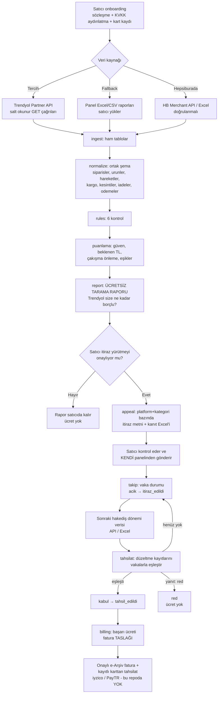
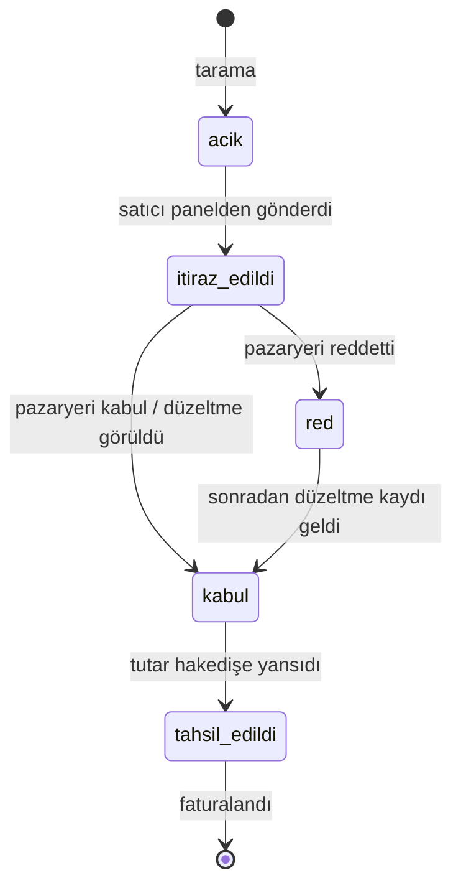

# Otomasyon akışı (AKIŞ)

> Bu belge tasarımdır. Bu repodaki kod **hiçbir pazaryerine, satıcıya veya kişiye bir şey göndermez**;
> API istemcileri yalnızca taslaktır (`hakedis/ingest/api_istemci.py`, `CANLI_API_KAPALI = True`).
> "doğrulanmalı" işaretli her kural `config.yaml` içinde parametredir. Kaynaklar: [KAYNAKLAR.md](KAYNAKLAR.md)

## 1. Genel akış



Vaka durum makinesi (`hakedis/takip.py`):



## 2. Toplanan veriler

### Trendyol (Partner API, yalnızca GET; Basic Auth + `User-Agent` başlığı zorunlu)

| Veri | Uç nokta | Kullanım | Not |
|---|---|---|---|
| Sipariş paketleri | `GET /integration/order/sellers/{sellerId}/v2/orders` (getShipmentPackages) | Durum (Delivered, Cancelled, UnDelivered, Returned, UnSupplied…), tarih, barkod, tutar | v2 uç noktası **15.10.2026'dan itibaren zorunlu**; en fazla 2 haftalık tarih aralığı, size ≤ 200 |
| İadeler | `GET /integration/order/sellers/{sellerId}/claims` (getClaims) | `claimItemStatus` (Accepted, Rejected, …) | tarih filtresi lastModifiedDate'e göre |
| Ürünler | `GET /integration/product/sellers/{sellerId}/products` (filterProducts) | `dimensionalWeight` = ürün desisi | |
| Cari hesap - settlements | `GET /integration/finance/che/sellers/{sellerId}/settlements` | Sale, Return, CommissionPositive/Negative, SellerRevenuePositive/Negative, DeliveryFee… (`commissionAmount`, `sellerRevenue`, `paymentOrderId`, `paymentDate`) | Aralık ≤ 15 gün; `transactionType(s)` zorunlu; kayıtlar sipariş **teslim edildikten sonra** oluşur |
| Cari hesap - otherfinancials | `GET /integration/finance/che/sellers/{sellerId}/otherfinancials` | DeductionInvoices (kesinti faturaları; `transactionSubType=PlatformServiceFee`), PaymentOrder, FinancialItem (düzeltmeler), CommissionAgreementInvoice, ReturnInvoice | Aralık ≤ 15 gün |
| Ödeme emirleri | `GET /integration/finance/che/sellers/{sellerId}/payment-order` | PAID ödeme emirleri → `paymentOrderId` | size ≤ 10 |
| Kargo faturası kalemleri | `GET /integration/finance/che/sellers/{sellerId}/cargo-invoice/{invoiceSerialNumber}/items` | Paket bazında `shipmentPackageType` (Gönderi/İade Kargo Bedeli), `parcelUniqueId`, `orderNumber`, `amount`, `desi` | `invoiceSerialNumber` = DeductionInvoices içindeki "Kargo Faturası" kayıtlarının `id`'si |

**Excel fallback:** Satıcı panelden indirdiği sipariş / cari hesap ekstresi / kargo faturası raporlarını
yükler. Panel başlıkları `config.yaml > kolon_eslemesi` ile API alan adlarına eşlenir
(başlık adları **doğrulanmalı**: gerçek bir panel çıktısıyla teyit edilmedi).

### Hepsiburada (doğrulanmalı)

Resmî geliştirici portalı sayfaları bu çalışmada açılamadı; uç noktalar üçüncü taraf açık kaynak SDK'dan
(loncadev/lonca) alınmıştır: `GET https://oms-external.hepsiburada.com/transactions/merchantId/{merchantId}`
("Kayıt Bazlı Muhasebe Servisi": `beginDate`, `endDate`, `offset`, `limit`), `GET /claims/merchantId/{merchantId}`,
sipariş servisleri. Desi, takip no ve ödeme durumu alanları örnekte **varsayımdır**. Pratikte ilk sürümde
Hepsiburada için Excel yükleme ile başlanması önerilir.

## 3. Kontroller (`hakedis/rules/`)

| Kural | Mantık | Kanıt | Güven (tahmin) | Parametreler / doğrulanmalı |
|---|---|---|---|---|
| `iade_komisyonu` | Kabul edilmiş iade + hakedişten düşülmüş Return kaydı var, ama Return kaydındaki komisyon iadesi < Sale kaydındaki komisyon | Sale + Return satırları (`commissionAmount`, `sellerRevenue`) | 0,90 | `iadede_komisyon_iade_edilir` (Trendyol dokümanındaki Return işaret tablosu bunu destekliyor; satıcı sözleşmesiyle teyit) |
| `desi_farki` | Kargo faturasındaki desi > ⌈Σ ürün desisi × adet⌉ + tolerans → fark = faturalanan − tarife(beklenen desi) | Kargo kalemi + ürün desisi + tarife | 0,60 gönderi / 0,50 iade | `tolerans_desi` (bilinmiyor), `kargo_tarifesi` (**örnek tarife**, satıcının anlaşmalı tarifesi girilmeli) |
| `iptal_kargo` | İptal / tedarik edilemeyen siparişe "Gönderi Kargo Bedeli" | Kargo kalemi + sipariş durumu | 0,85; teslim edilemeyen 0,40 | Teslim edilemeyen siparişte kargonun kime ait olduğu **doğrulanmalı** (bu yüzden "incelenmeli") |
| `mukerrer_kesinti` | Aynı `parcelUniqueId` + tip iki kez faturalanmış; sipariş başına tekil kesinti (ör. Platform Hizmet Bedeli) iki kez | Tekrarlayan satırlar | 0,90 | Tekil kesinti tipleri listesi |
| `dayanaksiz_kesinti` | Termin cezası ama termin içinde kargolanmış; tedarik edememe cezası ama teslim edilmiş; bilinmeyen kesinti tipi | Kesinti satırı + sipariş tarihleri | 0,70 / 0,85 / 0,30 | Kesinti açıklama metinleri **örnek**; gerçek rapordaki adlarla eşlenmeli |
| `odenmeyen_hakedis` | Teslim edilmiş siparişin Sale kaydının vadesi + tolerans geçmiş, `paymentOrderId` yok; ya da teslimden X gün sonra Sale kaydı hiç yok | Sale satırı / sipariş satırı | 0,80 / 0,60 | `kayit_olusma_tolerans_gun`, `odeme_tolerans_gun`; Trendyol ödeme emirleri "istisnalar hariç her çarşamba" oluşur |

## 4. Puanlama (`hakedis/puanlama.py`)

1. **Çakışma önleme:** Her bulgu talep ettiği kaynak satırları (`kargo:<satir_id>`, `kesinti:<id>`…) taşır.
   `kural_onceligi` sırasına göre ilk kural satırı alır; aynı satırı isteyen sonraki bulgu `cakisma` olur
   (ör. iptal edilmiş siparişin kargo satırı hem `iptal_kargo` hem `desi_farki` sayılmaz).
2. **Beklenen TL** = tutar × güven (tahmin). Öncelik: ≥100 TL yüksek, ≥30 TL orta.
3. **Kararlar:** güven < `min_guven` → `incelenmeli`; tutar < `min_bulgu_tutari_tl` → `esik_alti`;
   platform+kategori paketi < `min_paket_tutari_tl` → `devreden` (sonraki döneme); satıcının dönem toplamı
   < `min_donem_tutari_tl` → `donem_esik_alti`; kalanlar → `dosyalanacak`.

## 5. İtiraz üretimi (`hakedis/appeal.py`)

- Platform + kategori başına **tek paket**: Türkçe şablon metin (`*_itiraz.txt`) + kanıt Excel'i (`*_kanit.xlsx`:
  Ozet / Kanitlar / BILGI sayfaları). Trendyol'da hatalı desi bildirimleri pratikte Excel listesi ile canlı destek
  üzerinden iletiliyor (üçüncü taraf kaynak, doğrulanmalı).
- Metinde `[SATICI EKLEMELİ: …]` yer tutucuları (ör. tartı fotoğrafı) bulunur.
- LLM ile üslup iyileştirme isteğe bağlıdır (`config.llm.aktif`), varsayılan kapalı; bu iskelette çağrı yoktur.
  Tutar ve sipariş numaraları her zaman şablondan gelir, LLM'e hesaplattırılmaz.
- **Gönderimi satıcı yapar.** Ürün, satıcı adına pazaryerine otomatik mesaj göndermez (hesap güvenliği,
  pazaryeri kullanım koşulları ve sorumluluk açısından).

## 6. Vaka takibi ve tahsilat tespiti

- `takip.py`: `acik → itiraz_edildi → kabul/red → tahsil_edildi`; geçersiz geçişler hata verir; tarihçe tutulur.
- `tahsilat.py`: Sonraki dönem verisinde pozitif düzeltme kayıtları (`config.tahsilat.eslestirme`; ör. iade komisyonu
  için `CommissionNegative`/`SellerRevenuePositive`, kargo/kesinti için `FinancialItem`) aynı platform + sipariş no
  ile vakaya eşlenir; eşlenen tutar vakanın kalan talebini aşamaz (kısmi tahsilat desteklenir). Vakayla ilgisi
  olmayan düzeltmeler raporlanır ama **ücretlendirilmez**. Pazaryerinin düzeltmeyi hangi kayıt tipiyle attığı
  **doğrulanmalı** (ilk 5 pilot satıcıda gözlemlenmeli).
- `billing.py`: Yalnızca `tahsil_edildi` ve faturalanmamış vakalar için fatura **taslağı** üretir; aynı vaka iki kez
  faturalanmaz. Gerçek e-Arşiv fatura ve karttan çekim bu repoda yoktur.

## 7. Komutlar

```bash
python -m hakedis scan   --input ornek_veri/ --out cikti/
python -m hakedis simule --input ornek_veri/ --sonraki ornek_veri/sonraki_donem/ --out cikti/ornek_sonuc/
python -m hakedis durum  --vakalar cikti/ --vaka TY-IKO-0001 --yeni itiraz_edildi
python -m hakedis tahsilat --vakalar cikti/ --sonraki <sonraki_donem_klasoru> --out cikti/
```
